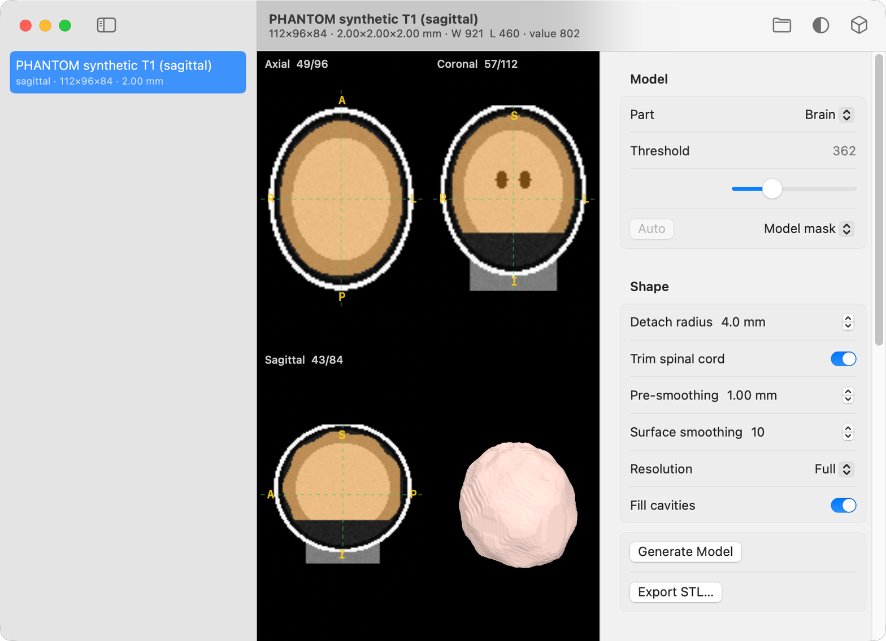
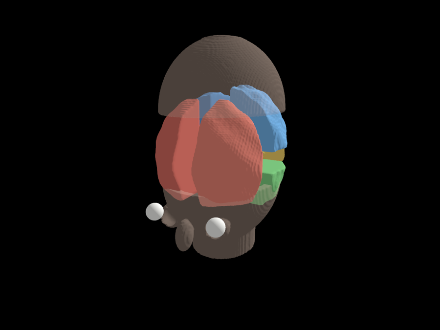

# MRI Viewer

A small native macOS app (SwiftUI + AppKit) for browsing DICOM MRI studies, plus a 3D-print model
generator. You can turn a 3D brain scan into a watertight STL, or into a **multi-part print kit**:
anatomical brain lobes that fit together inside a hollow head that splits in two.




*Both images show the synthetic phantom that ships with the tools. This repository contains no real
scan data.*

## Features

- Opens a folder of DICOM files (searched recursively; the DICOMDIR is not required) and groups them into
  series/stacks.
- Linked axial / coronal / sagittal views in radiological convention, with physical aspect ratio,
  orientation letters and a crosshair.
  - Click or drag to move the crosshair. Scroll or use the arrow keys to change slice. Right-drag or
    ⌥-drag to adjust window/level.
- Decodes uncompressed (implicit/explicit VR little-endian), **JPEG 2000 lossless/lossy** and 8-bit
  baseline JPEG data.
- **3D model panel**: brain, head (skin) or raw iso-surface. It has a live threshold overlay on the
  slices and a model-mask overlay after generation, a shaded 3D preview, and export to binary STL in
  millimetres, sitting on z = 0.
- **Print kit** (see below): brain lobes, cerebellum, brainstem and optional deep structures from a
  FastSurfer segmentation, plus a hollow head split horizontally, with eyeballs when the scan
  includes the face.
- Smooth surfaces: the surface follows the scan's own intensity edge (sub-voxel), not the blocky
  segmentation mask. The segmentation only decides *what* is included.
- Meshes are closed 2-manifolds (marching tetrahedra on a padded field), cleaned of floating debris,
  and Taubin-smoothed so they don't shrink. The panel reports triangle count, size, volume and
  watertightness.

## Build & run

Requires macOS 14+ and Xcode 15+ (Swift 5.9+). The package has no external dependencies: OpenJPEG is
vendored.

```sh
scripts/make-app.sh                 # → build/MRI Viewer.app   (or: mise run app)
open "build/MRI Viewer.app"         # then ⌘O and pick the folder containing your DICOM files
mise run demo                       # opens a synthetic phantom instead of real data
swift test                          # unit + end-to-end tests (synthetic data only)
```

`swift build` and `xcodebuild -scheme MRIViewer-Package -destination 'platform=macOS' build` both work.

## Making a 3D print

In the app, open the 3D model panel (cube button) and pick **Brain**. Adjust the threshold while watching
the orange overlay, then click **Generate Model** (⌘G) and **Export STL…** (⌘E).

From the command line:

```sh
BIN=$(swift build -c release --show-bin-path)
$BIN/mritool info /path/to/dicom-folder                 # list series (technical parameters only)
$BIN/mritool stl  /path/to/dicom-folder brain.stl       # auto-picks the largest 3D series
$BIN/mritool stl  /path/to/dicom-folder head.stl --mode head
$BIN/mritool check-stl brain.stl                        # watertight / size / volume report
```

Useful `stl` options include `--series N`, `--threshold T`, `--erode MM`, `--smooth-mm S`,
`--taubin N`, `--downsample 2` (about 4× fewer triangles) and `--trim-tail 0` (keep the spinal cord).
Run `mritool` with no arguments for the full list.

**Which scan works best:** a 3D T1-weighted series with roughly 1 mm isotropic voxels (often named
`mprage`, `t1_mprage`, `bravo`, `spgr` or `3D T1`). The 2D series with thick slices (3–5 mm) produce
blocky models.

**How brain mode works:** smooth, then threshold between CSF and grey matter. The automatic threshold
is 0.45 × the white-matter intensity, which it estimates from tissue at least 25 mm inside the skin.
It then erodes 4 mm to cut the brain loose from the scalp, keeps the largest piece, and grows it back
inside the threshold. Finally it fills the ventricles and trims the spinal cord where the axial
cross-section falls below 5 % of its maximum, which also gives the print a flat base. This is a simple
morphological skull strip, not a research-grade segmentation. Check the overlay and adjust the
threshold or detach radius if bits of dura or eye are included.

## Print kit: brain regions that fit inside a split head

1. **Segment the brain** with [FastSurfer](https://github.com/Deep-MI/FastSurfer), an open-source
   (Apache-2.0) deep-learning segmenter that runs locally on Apple silicon.
   - Install the [macOS package](https://deep-mi.org/FastSurfer/dev/overview/install/MACOS.html):
     about 1 GB to download, 2.4 GB installed, no license needed for segmentation.
   - Then either:
     - In the app, switch the 3D panel to **Print kit** and click **Run FastSurfer**. It takes
       about 1–2 minutes, and results are cached per series.
     - Or run `scripts/fastsurfer-segment.sh <dicom-dir> <out-dir>` to get `<out-dir>/labels.mgz`.
   - Any FreeSurfer-style `aparc.DKTatlas+aseg` label map (`.mgz`/`.nii`) also works through
     **Load Labels…**.
2. Check the **Regions** overlay on the slices, then **Generate Kit**. The preview has an
   exploded-view slider and a see-through head.
3. **Export Kit…** writes one STL per part plus `kit.txt` (sizes, volumes, checks). All parts share
   one coordinate frame, so importing them together in a slicer shows the assembled model.

CLI equivalent: `mritool kit <dicom-dir> labels.mgz <out-dir>` (`--deep`, `--no-eyes`,
`--clearance`, `--gap`, `--split`, `--min-wall`).

The parts:

| Part | Made from |
|---|---|
| left/right frontal, parietal, temporal, occipital | DKT cortical parcels per lobe (cingulate split front/back, insula with temporal); white matter is assigned to the nearest lobe in the same hemisphere |
| cerebellum, brainstem | aseg cerebellum; brainstem + ventral diencephalon, cord trimmed for a flat base |
| deep pieces (optional) | basal ganglia + thalamus, hippocampus + amygdala (per side), ventricle cast |
| head top / head bottom | skin surface minus a cavity matching the brain (+1 mm clearance), cut at the brain's widest level so the brain drops into the bowl; walls are thickened to ≥ 2 mm |
| eyes (optional) | detected vitreous/orbital-fat spheres, with sockets that open to the front |

Neighbouring brain parts are separated by a 0.2 mm gap. The outer brain surface follows the scan
intensity, and the cuts between parts follow the segmentation.

- **Eyeballs need the face to be in the scan.** Many exports are *defaced* for anonymity. The tool
  checks this (`mritool face-check <dir>` shows how far forward the head reaches) and skips the eyes,
  rather than guessing, when the face is missing.
- **Undercuts:** `kit.txt` reports any cavity volume that a straight vertical lift can't reach. The
  temporal lobes usually tuck under the bowl's rim, but since the brain comes out in pieces, each
  part can be angled in.

**Printing tips:** a full-resolution brain is about 1 M triangles (≈ 55 MB STL), which slicers handle
fine. At 100 % scale it's about 13 × 17 × 12 cm, so most people print at 50–70 %. The bottom is flat
when the spinal cord is trimmed. For a two-hemisphere print, split the model along the midline in your
slicer.

## Privacy

The tools only read **technical DICOM fields**: geometry, pixel format, series description, modality
and UIDs used for grouping. Patient name, ID, birth date, dates, institution and operator fields are
never read, stored or shown, and `mritool` prints only technical parameters and aggregate numbers.

To keep scan data out of git:

- `.gitignore` excludes DICOM, NIfTI and mesh files.
- `scripts/check-no-medical-data.sh` fails if any tracked file is a DICOM file (detected by its
  `DICM` magic, whatever the file name) or a volume/mesh file. Install it as a hook:
  `ln -sf ../../scripts/check-no-medical-data.sh .git/hooks/pre-commit`.
- The `--render-check` probe refuses to render anything except the synthetic phantom unless you
  explicitly override it.

The tests and screenshots use `mritool phantom`, a made-up analytic head (skin, skull, CSF, grey/white
matter, ventricles and an orientation marker) that can be written as uncompressed or JPEG 2000 DICOM.

## Verification

- `swift test` runs 19 tests:
  - DICOM round-trips for axial, coronal, sagittal and oblique acquisitions × implicit, explicit and
    JPEG 2000.
  - Radiological orientation checked against a left-anterior-superior marker in every acquisition
    plane.
  - A distance transform compared with brute force.
  - Sphere meshes: watertight, Euler characteristic 2, volume within 2 %.
  - STL round-trip.
  - Brain mode on a noisy phantom: volume within 5 % of the analytic value.
  - The intensity-guided surface is measurably less stepped than the mask surface.
  - Print kit on the phantom: every part watertight, no overlaps, eyes within 2 mm of the truth, and
    no brain vertex inside the head shell.
  - NIfTI and MGZ (gzip, FreeSurfer LIA geometry) round-trips.
- `mritool label-check <dir> <labels>` measures how well a label map aligns with the scan: Dice
  overlap and centroid offset against the intensity-based brain mask.
- `scripts/verify_j2k.py` cross-checks the JPEG 2000 decoder against pydicom + OpenJPEG. Run
  `mritool verify-decode <dir> <tmp>` first, then the script; it prints agreement statistics only.
- The app has probe modes for scripted checks:
  - `MRIViewer --open <dir> --probe` loads through the real UI store, builds a model, prints the
    numbers and exits non-zero if the mesh isn't watertight.
  - `MRIViewer --render-check <phantom-dir> <out>` writes PNGs of the three planes.
  - `MRIViewer --render-kit <phantom-dir> <labels> <out.png>` renders the kit preview offscreen.
  - `MRIViewer --open <dir> --labels <file>` builds a kit through the app's store and prints the
    parts.

## Limitations

- **Not a medical device.** Do not use it for diagnosis.
- Views show the volume's nearest native planes. Oblique acquisitions are not resampled, so they
  appear tilted.
- Supports classic single-frame images (one slice per file) and native multi-frame data. Enhanced
  multi-frame per-frame geometry, JPEG-LS, lossless JPEG (process 14), RLE and big-endian files are
  not supported.
- No mesh decimation. Full-resolution parts run to 0.2–2 M triangles each (head halves are the
  largest). Use `--downsample` or your slicer's simplify tool if your slicer struggles.
- The lobe split follows the DKT atlas grouping. White matter has no lobe labels, so its split is
  approximate (nearest cortex).

## Layout

```
Sources/COpenJPEG/   vendored OpenJPEG 2.5.3 (BSD-2-Clause) — see VENDORED.md
Sources/MRICore/     DICOM parsing, decoding, volume assembly, reslicing, filters, meshing, STL, phantom
Sources/MRIViewer/   SwiftUI app (+ probes)
Sources/mritool/     command-line tool
Tests/MRICoreTests/  tests (synthetic data only)
scripts/             app bundling, data-leak check, J2K cross-check, OpenJPEG re-vendoring,
                     FastSurfer segmentation wrapper
```

## License

MIT (see `LICENSE`). OpenJPEG is BSD-2-Clause (`Sources/COpenJPEG/LICENSE`).
